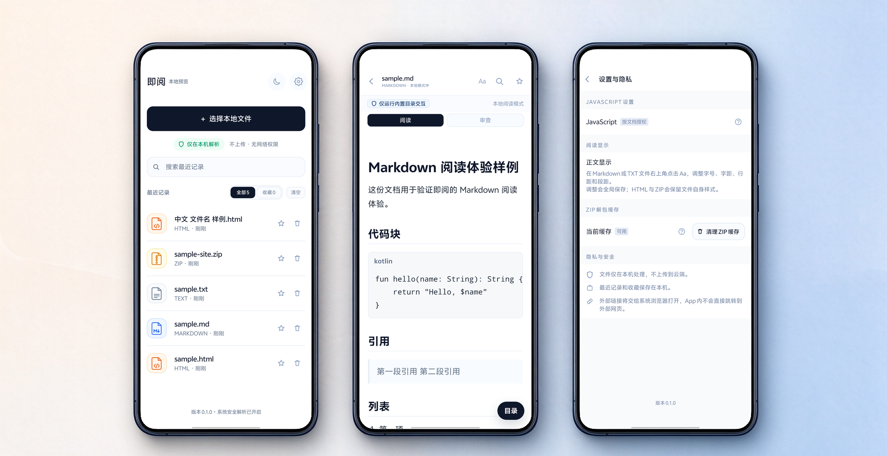

<p align="center">
  
</p>

<h1 align="center">即阅 InstantRead</h1>

<p align="center">本地优先的 Android 阅读器，打开 HTML、Markdown、TXT 与 ZIP 网页包。</p>

<p align="center">
  最新版 <b>0.1.0</b> · Android 6.0+ · 917 KB ·
  <a href="https://github.com/ShikaC/InstantRead/releases/latest">下载 APK</a>
</p>

<p align="center">
  
</p>

<p align="center">真机界面：首页 · Markdown 阅读 · 设置与隐私</p>

## 功能

- **HTML**（`.html` / `.htm`）：受限 WebView 预览本地页面，外部链接交给系统浏览器。
- **Markdown**（`.md` / `.markdown`）：阅读与审查模式、全文搜索、阅读位置恢复、Aa 显示设置、浮动目录。
- **TXT**（`.txt`）：自动识别 UTF-8（含 BOM）、UTF-16LE / UTF-16BE、GB18030，提供可读排版与搜索。
- **ZIP 网页包**（`.zip`）：安全解包并自动选择 `index.html` 入口，包内相对样式与图片一起呈现。
- **资料管理**：最近记录、收藏、单条删除与「清空未收藏记录」、ZIP 缓存清理。

## 下载

[Releases](https://github.com/ShikaC/InstantRead/releases/latest) 提供已签名的安装包：

| 项目 | 值 |
| --- | --- |
| 文件 | `instantread-0.1.0-release.apk` |
| 版本 | `versionCode=2` · `versionName=0.1.0` |
| 大小 | 917,193 字节 |
| 系统 | Android 6.0（API 23）及以上 |
| SHA-256 | `1e7e442ed152d516c38c3f0286ee194d0ebe4928766b9620946bf11190e4bcfa` |

在手机上允许「安装未知来源应用」后即可安装。后续版本沿用同一签名，覆盖安装会保留最近记录与收藏。

校验下载文件：

```sh
shasum -a 256 instantread-0.1.0-release.apk
```

签名证书 SHA-256：`03748f77c67106b7b95a511422483d798d5ef6b1130f870d3363a1f9324190d3`（RSA 4096，v1 + v2 签名）。

## 隐私与安全

- 文件全程在本机解析，应用在离线环境下也能完整工作。
- 导入时复制一份到应用私有目录，手机里的原始文件保持原样，卸载即清理。
- 脚本按需放行：HTML 与 ZIP 包内脚本默认以安全模式渲染，你可以在预览页对当前文档单独授权，撤销立即生效。
- 每个文档只读取自己副本目录内的资源，越界访问会被拦截并提示页面可能不完整。

详见 [隐私说明](PRIVACY.md) 与 [安全说明](SECURITY.md)。

## 从源码构建

要求 JDK 17 与 Android SDK 34：

```sh
cd apps/android-instantread
./gradlew --no-daemon :app:testDebugUnitTest :app:testReleaseUnitTest :app:lintDebug :app:assembleDebug
```

Windows 使用 `.\gradlew.bat`，debug APK 输出在 `apps/android-instantread/app/build/outputs/apk/debug/`。

## 说明

- 预览内搜索区分大小写。
- 单文件 Markdown 以正文阅读为主，带相对资源时打包为 ZIP 更完整。
- 真机验收覆盖一台 vivo 设备（Android 16），其它机型的表现欢迎在 Issue 中反馈。

## 反馈

- 缺陷与使用问题请开 [Issue](https://github.com/ShikaC/InstantRead/issues)，模板会询问版本、导入来源与复现步骤；仓库内 `docs/validation/android-instantread/samples/` 备有一组对比样例。
- 安全问题请走仓库的私密漏洞报告入口。

## 许可证

[MIT](LICENSE)。打包进 APK 的第三方组件见 [第三方组件许可说明](THIRD-PARTY-NOTICES.md)。
