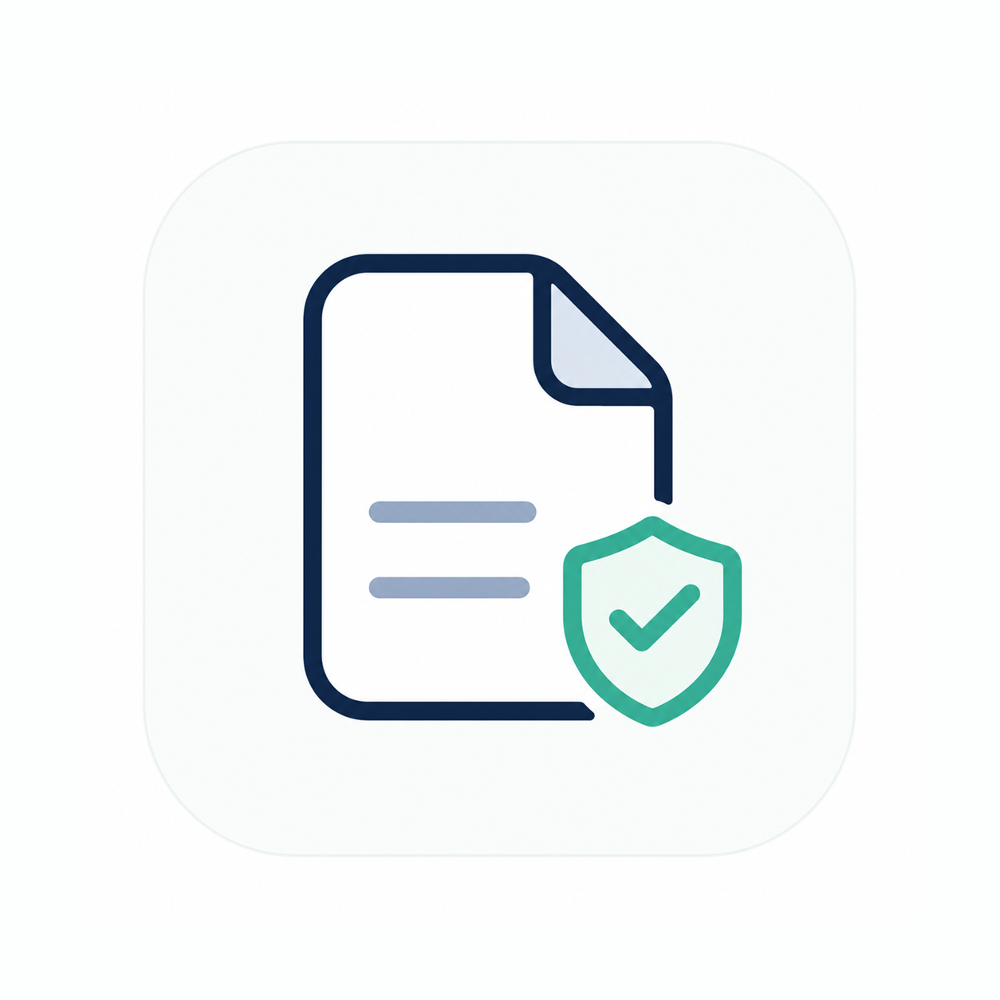

<p align="center">
  
</p>

<h1 align="center">即阅 InstantRead</h1>

<p align="center">在 Android 上导入即看 HTML、Markdown、TXT 与 ZIP 网页包。</p>

即阅是一款本地优先的 Android 文件阅读与网页包预览应用。它把 App 内选择、系统打开方式和单文件分享收敛为统一导入流程，让本地文档进入应用后即可阅读；文件复制到 App 私有目录处理，不依赖云端，也不申请网络权限。

**最新稳定版：0.1.0** ｜ Android 6.0（API 23）及以上 ｜ `instantread-0.1.0-release.apk`（917,193 字节）

**下载：[GitHub Releases](https://github.com/ShikaC/InstantRead/releases/latest)**

## 核心能力

- **HTML**（`.html` / `.htm`）：使用受限 WebView 预览本地页面，外部链接交给系统浏览器。
- **Markdown**（`.md` / `.markdown`）：阅读与审查模式、全文搜索、阅读位置恢复、Aa 显示设置、浮动目录与当前位置跟踪；支持 ZIP 附件包中的相对图片。
- **TXT**（`.txt`）：自动识别 UTF-8（含 BOM）、UTF-16LE / UTF-16BE、GB18030，提供可读排版、搜索与阅读位置恢复。
- **ZIP 网页包**（`.zip`）：安全解包并自动选择 HTML 入口；没有 HTML 时回退到 `index.md` 等 Markdown 入口渲染为阅读页，包内相对 CSS 与图片可正常加载。
- **本地资料管理**：最近记录、收藏、单条删除与「清空未收藏记录」、ZIP 缓存清理；删除只清理应用内副本与缓存，手机里的原始文件不受影响。

## 支持的格式

| 格式 | 打开方式 | 边界 |
| --- | --- | --- |
| `.html` / `.htm` | 受限 WebView 预览 | 脚本默认关闭；联网资源与越界文件被拦截，缺失的本地资源会提示打包为 ZIP |
| `.md` / `.markdown` | 正文阅读 / 审查模式 | 单文件不解析相对图片，需要相对资源时请打包为 ZIP |
| `.txt` | 纯文本阅读 | 自动识别常见编码；超过上限或无法识别的编码会给出明确提示 |
| `.zip` | 网页包 | 以包内 `index.html` 为入口，无 HTML 时回退 `index.md` / `index.markdown` |

## 隐私与安全

- **不申请网络权限**：应用清单中没有 `INTERNET` 权限，没有统计与第三方 SDK，文件只在本机解析。
- **私有目录副本**：导入的文件复制到 App 私有目录后处理，不上传、不写入共享存储，卸载即删除。
- **JavaScript 默认关闭**：HTML 与 ZIP 包内脚本只能在预览页对当前文档单独授权，撤销立即生效，重新导入不继承。
- **资源隔离**：每个文档只能读取自己副本目录内的资源，网络地址与越界文件被拦截并提示页面可能不完整。
- **ZIP 安全边界**：防止路径穿越，并限制条目数量、单条目大小、展开总大小与导入耗时。

详见 [隐私说明](PRIVACY.md) 与 [安全说明](SECURITY.md)。

## 下载与安装

1. 打开 [Releases](https://github.com/ShikaC/InstantRead/releases/latest)，下载 `instantread-0.1.0-release.apk`。
2. 在手机上允许「安装未知来源应用」，点开 APK 安装。
3. 后续版本使用同一签名密钥，直接覆盖安装即可，最近记录与收藏会保留。

### 校验下载文件

`instantread-0.1.0-release.apk` 的 SHA-256：

```text
1e7e442ed152d516c38c3f0286ee194d0ebe4928766b9620946bf11190e4bcfa
```

```sh
# macOS / Linux
shasum -a 256 instantread-0.1.0-release.apk
```

```powershell
# Windows PowerShell
Get-FileHash .\instantread-0.1.0-release.apk -Algorithm SHA256
```

### 签名身份

- 签名者：`CN=ShikaC, OU=InstantRead Release, O=ShikaC, C=CN`
- 证书 SHA-256：`03748f77c67106b7b95a511422483d798d5ef6b1130f870d3363a1f9324190d3`
- 密钥：RSA 4096；APK 签名方案 v1 与 v2 均通过

如果证书指纹与上面不一致，请不要安装，并走仓库的私密安全报告入口反馈。

## 从源码构建

要求 JDK 17 与 Android SDK 34。Gradle wrapper 位于 `apps/android-instantread`：

```sh
cd apps/android-instantread
./gradlew --no-daemon :app:testDebugUnitTest :app:testReleaseUnitTest :app:lintDebug :app:assembleDebug
```

Windows 使用 `.\gradlew.bat`。debug APK 输出到：

```text
apps/android-instantread/app/build/outputs/apk/debug/app-debug.apk
```

## 技术栈

| 范围 | 技术 |
| --- | --- |
| Android 客户端 | Kotlin、Android SDK、原生 programmatic View |
| 内容预览 | WebView、HTML / CSS、受控 JavaScript |
| 本地数据 | App 私有存储、SQLiteOpenHelper |
| 构建与验证 | Gradle、JUnit 4、Robolectric、ADB |

## 验证状态

`0.1.0` 是首个稳定版，候选产物已完成自动化与真机验收：

- debug / release 两个变体分别通过 58 个 test suite、556 项测试，0 失败、0 错误、0 跳过；`lintDebug` 0 错误。
- 在一台 vivo 设备（Android 16）上完成 HTML、Markdown、TXT、ZIP 四格式与中文编码、系统文件管理器 / 聊天分享 / 浏览器下载来源、脚本授权与撤销、恶意与损坏 ZIP、旋转与深浅色、大字体，以及 `0.1.0-rc1` → `0.1.0` 同签名覆盖升级验收。

## 已知限制

- 预览内搜索区分大小写。
- 单文件 Markdown 不解析相对图片，需要连同资源打包为 ZIP。
- 「分享到多个文件」（`ACTION_SEND_MULTIPLE`）只处理单文件，多选分享会被忽略。
- 真机验收只在单台 vivo 设备（Android 16）上完成；未覆盖第二个手机品牌、Android 6（API 23）设备、屏幕阅读器与低存储场景。
- 不包含 PDF / Office 内置预览、账号、云同步与多设备同步。

## 反馈与安全

- 缺陷与使用问题请开 Issue，模板会询问版本、导入来源与复现步骤；仓库内 `docs/validation/android-instantread/samples/` 提供了一组可用于对比的样例文件。
- 安全问题请走私密漏洞报告，不要开公开 Issue，见 [安全说明](SECURITY.md)。
- 数据处理方式见 [隐私说明](PRIVACY.md)。

## 许可证

本项目以 [MIT 许可证](LICENSE)发布。打包进 APK 的第三方组件及其许可见 [第三方组件许可说明](THIRD-PARTY-NOTICES.md)。
